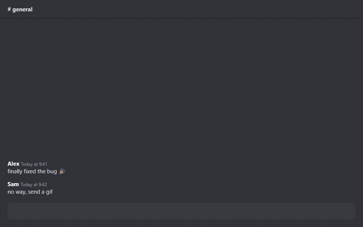

<p align="center"></p>

<h1 align="center">GIF Anywhere</h1>

<p align="center">A GIF button in every text box. Search Tenor and drop a GIF into Discord, Facebook, X, WhatsApp, ChatGPT and more.</p>

<p align="center"></p>

## Use

1. Click into any message or comment box. A blue **GIF** button appears at its right end.
2. Click it (or press **Alt+G**), search, and click a GIF.
3. The GIF is pasted into your box like a copied image. Tick **Link** to insert the Tenor link instead;
   the choice is remembered per site.

Click the toolbar icon to turn GIF Anywhere on or off. The icon shows **ON** while it is on.

## Install from source

1. Download or clone this repository.
2. Open `chrome://extensions` (or `edge://extensions`) and turn on **Developer mode**.
3. Click **Load unpacked** and choose the `extension` folder.

## How it works

| File | Job |
| --- | --- |
| `extension/content.js` | Shows the GIF button on the focused text box and inserts the picked GIF |
| `extension/picker.html`, `picker.js` | The search window, loaded in an extension iframe so strict sites cannot block the previews |
| `extension/tenor.js` | Tenor search |
| `extension/background.js` | On/off toggle and the Alt+G shortcut |

The GIF is inserted by firing a paste event that carries the GIF file, which chat sites handle like a
pasted image. If a site ignores it, the Tenor link is typed instead.

## Limits

- Tenor closed its public API in June 2026, so search reads tenor.com's search page. It breaks if Tenor
  changes that page.
- Sites that only accept real keyboard pastes may ignore the file; use **Link** there.
- Does not run on `chrome://` pages, the Web Store, or inside cross-site iframes.

## Privacy

No account, no tracking, no ads. Your typing is never read or sent anywhere; only GIF searches go to
Tenor. See [PRIVACY.md](PRIVACY.md).

## Development

```bash
cd tests && npm install && cd ..
node tests/e2e.cjs msedge
node store/make-assets.cjs
powershell -File store/build-zip.ps1
```

- `tests/e2e.cjs` loads the extension into your installed Edge (pass `chrome` for Chrome) on a fake chat
  page with a strict Content-Security-Policy. It searches the real tenor.com but posts nothing.
- `store/make-assets.cjs` renders the icons, the store screenshot and the promo tile.
- `store/make-demo.cjs` records `store/demo.gif` (needs ffmpeg on PATH).
- `store/build-zip.ps1` packs `extension/` into the zip you upload to the Chrome Web Store.

## License

[MIT](LICENSE). GIF Anywhere is an independent project and is not affiliated with Tenor or Google.
GIFs are provided by Tenor and belong to their owners.
